# Code Squad

[](https://github.com/acarmisc/the-office-ai-squad/actions/workflows/ci.yml)
[](https://github.com/acarmisc/the-office-ai-squad/actions/workflows/release.yml)
[](https://github.com/acarmisc?tab=packages&repo_name=the-office-ai-squad)
[](docs/deployment/images-and-releases.md)

Code Squad is a set of specialised review and engineering agents for GitLab and GitHub changes. It runs on any Kubernetes cluster,
calls models only through an LLM gateway, and is configured per project rather than coded. It reviews change requests, checks
security and pipeline risk, and can implement a task in a sandbox and open a change request for a human to review. It never merges
and never changes a cluster.



*Recorded from `uv run python -m scripts.demo_review`. The transcript is [docs/assets/casts/review.cast](docs/assets/casts/review.cast);
play it locally with `asciinema play docs/assets/casts/review.cast`.*

## Agents

Six agents, one image. Each agent is started with a different `AGENT_NAME`. The ids are names from *The Office* (US), kept for
discoverability; every output uses the functional role.

| Id | Role | What it does |
| --- | --- | --- |
| `michael` | Orchestrator | Receives webhooks and requests, routes a change to the specialists and publishes one consolidated review. |
| `jim` | React reviewer | Reviews React and TypeScript changes. |
| `angela` | Java reviewer | Reviews Java and JVM changes, including Spring. |
| `dwight` | Security reviewer | Reviews code, configuration and dependencies, and checks live vulnerability data. |
| `darryl` | DevOps specialist | Reviews CI/CD, containers, IaC and Kubernetes manifests; troubleshoots incidents with read-only access. |
| `pam` | Frontend engineer | Implements a task in a sandbox, runs the project's checks, pushes a branch and opens a change request. |

Every verdict is `approve`, `comment`, `request_changes` or `incomplete`. A failed specialist never produces a success: the outcome is
`incomplete`. Dry run is the default way to test, and it performs no external write.

## Quick start (offline, about 5 minutes)

No API key and no VCS account are needed. Two routes, with expected output, are in
[Local demo](docs/getting-started/local-demo.md).

```bash
uv sync
uv run python -m scripts.demo_review        # one dry-run review, scripted model, fake VCS
```

Or start all six agents with Docker Compose and an offline fake LLM:

```bash
docker compose -f deploy/compose.yaml up -d --build
scripts/smoke_test.sh compose               # ends with: smoke compose: all 6 agents passed
docker compose -f deploy/compose.yaml down
```

## Deploy (Helm, about 15 minutes)

The chart and the images are published to GitHub Container Registry for each release tag. The first install, with a minimal values
file that runs in dry-run mode, is walked through in [Deploy to Kubernetes](docs/getting-started/deploy-to-kubernetes.md):

```bash
helm upgrade --install code-squad oci://ghcr.io/acarmisc/charts/code-squad \
  --version 0.1.0 --namespace code-squad --create-namespace -f my-values.yaml
```

Release artifacts, digests and verification: [Images, charts and releases](docs/deployment/images-and-releases.md).
Something not working? [Troubleshooting](docs/getting-started/troubleshooting.md) maps symptoms to fixes.

## Documentation

- **Getting started:** [Local demo](docs/getting-started/local-demo.md), [Deploy to Kubernetes](docs/getting-started/deploy-to-kubernetes.md),
  [Troubleshooting](docs/getting-started/troubleshooting.md)
- **Architecture:** [Overview](docs/architecture/overview.md), [request lifecycle](docs/architecture/agent-lifecycle.md),
  [review sequence](docs/architecture/review-sequence.md), [HTTP contract](docs/architecture/contract.md)
- **Configuration:** [Concepts](docs/configuration/concepts.md), [recipes](docs/configuration/recipes.md),
  [configuration reference](docs/reference/configuration.md)
- **Projects:** [New project checklist](docs/onboarding/new-project.md), [GitLab](docs/vcs/gitlab.md), [GitHub](docs/vcs/github.md)
- **Operations:** [Runbook](docs/operations/runbook.md), [Secrets](docs/deployment/secrets.md),
  [Network and egress](docs/deployment/network-and-egress.md)
- **Contributing:** [CONTRIBUTING.md](CONTRIBUTING.md), [architecture tour](docs/contributing/tour.md),
  [your first change](docs/contributing/first-change.md)
- **Security:** [SECURITY.md](SECURITY.md), [threat model](docs/security/threat-model.md), [hardening](docs/security/hardening.md)
- **Governance:** [Code of Conduct](CODE_OF_CONDUCT.md), [decisions](docs/decisions/index.md), [FAQ](docs/faq.md),
  [handoff](docs/HANDOFF.md), [changelog](CHANGELOG.md)

## Development

```bash
uv sync
just check      # ruff, mypy --strict, pytest, prompt checks, docs drift, mkdocs --strict, helm lint, secret scan
just eval       # offline replay of the evaluation cases
just demos      # re-record the demo transcripts and animations under docs/assets
```

Read [AGENTS.md](AGENTS.md) and [CONTRIBUTING.md](CONTRIBUTING.md) before you change the code. The current state of the work is in
[STATUS.md](STATUS.md) and the [build brief](docs/BRIEF.md).

## Notes for operators

- The GitHub App manifest in `examples/github/github-app-manifest.json` requests `contents: write`. That permission is needed only
  when `pam` is deployed and used. Lower it to `read` otherwise.
- `/invocations` and `/jobs/{id}` require a shared bearer token. Without `SQUAD_API_TOKEN` (or `SQUAD_API_TOKEN_FILE`) they refuse
  every request, unless `SQUAD_ALLOW_UNAUTHENTICATED=1` is set, which is for local demos only. Keep the endpoints inside the cluster
  network. See [hardening](docs/security/hardening.md#api-authentication) and
  [ingress and webhooks](docs/deployment/ingress-webhooks.md).
