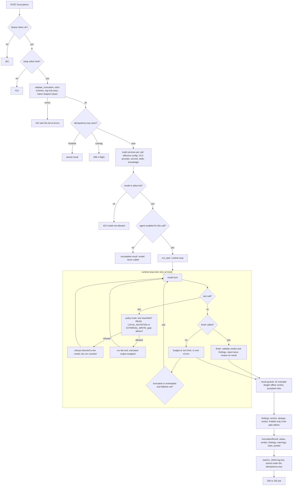

# Request lifecycle inside one agent

This page follows one `POST /invocations` through a single agent process: from validation to the result. It applies to every agent.
`michael` adds a fan-out step in front of this path (see [review sequence](review-sequence.md)), and its specialists then run this same
path with `post: false`.

## The path

## What each stage guarantees

| Stage | Where it lives | Guarantee |
| --- | --- | --- |
| Auth and size | `server.py` (`_authorized`, `_json_body`) | Refused before any parsing or model work. |
| Validation | `_common/validation.py` | Unknown keys and organisation-only keys are refused. Caller tags in reserved namespaces are dropped. |
| Idempotency | `server.py` (`_claim_key`, `InFlightRegistry`) | The same key gives the stored result, never a second run. |
| Services | `_common/services.py` (`ServiceBuilder`) | Built per call, so configuration changes apply without a restart. Secrets are resolved here, not in the agent prompt. |
| Allow-list and plan | `validation.model_allowlist_errors`, `services.plan_run` | A disallowed model or a disabled agent never reaches the model. |
| Runtime loop | `_common/runtime.py` (`run_task`, `_run`, `_attempt`) | Turn, token and wall-clock budgets. One retry on truncation or gateway overload, with `fallback_model`. |
| Policy hook | `_common/policy_hook.py`, `_common/tool_policy.py` | Every tool is classified. Under dry run the external-write gate refuses and records the attempt. |
| Finish | `runtime._finalize` | A run without a valid `finish` is `incomplete`, never `complete`. |
| Guards | `runtime._guarded` | Agent-specific checks run last on the finished result, in the order the services list them. |
| Publication | `_common/findings.py`, `_common/posting.py` | One pipeline. Writes only when `post` is true and no organisation override forces dry run. |

## Reading a result

- `status` says whether the run finished (`complete`), finished without a verdict (`incomplete`) or raised (`failed`).
- `warnings` explains every degraded or refused step in one line each. It is the first place to look.
- `stats` holds the iteration count, token counts and the `config_hash` that produced the run.
- `posted` counts what was written. In dry run it is zero.

## Where to add code on this path

| You want to | Change |
| --- | --- |
| Accept a new request field | `_common/contract.py` and the schema in `schemas/`; regenerate with `just docs-gen` |
| Add a service (for example a new client) | `_common/services.py`, built from configuration |
| Add a tool | [Your first change](../contributing/first-change.md#example-2-add-a-read-only-tool) |
| Change how a verdict is computed | `_common/findings.py`, with a test that fails on the old behaviour |
