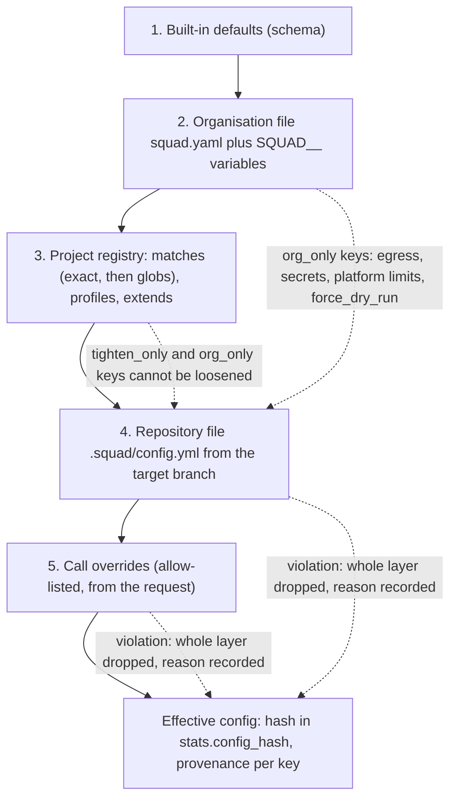
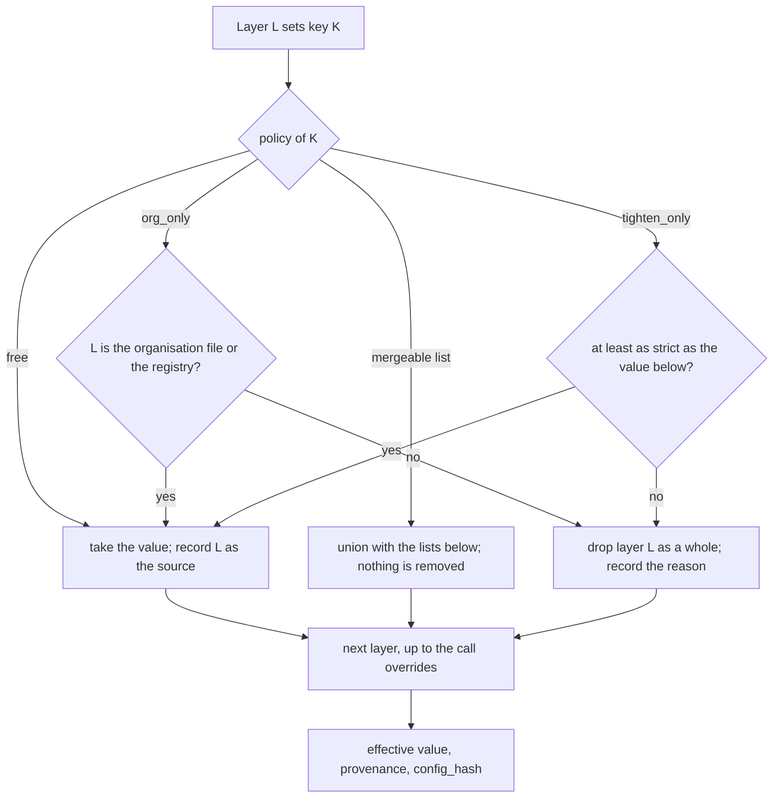

# Configuration layering

Behaviour is set by configuration, not code. Five layers apply to every invocation, and each
layer can only move a setting within the limits that the layers below it set. The rules are
implemented in `config/loader.py` and `config/merge.py`, and decided by the schema in
`config/schema.py`. This page is the picture; [Configuration concepts](../configuration/concepts.md)
explains each rule with examples.

## Layers

| Layer | Source | Who controls it | Failure behaviour |
| --- | --- | --- | --- |
| 1. Defaults | Schema defaults | Code | Not applicable. |
| 2. Organisation | `SQUAD_CONFIG_FILE` (default `/etc/squad/squad.yaml`) and `SQUAD__SECTION__KEY` variables | Platform operator | An invalid file fails closed: writes are disabled for the run and a warning is recorded. |
| 3. Registry | `SQUAD_PROJECTS_DIR` (default `/etc/squad/projects`) and profiles | Platform operator | An invalid file is a configuration error for the project. |
| 4. Repository | `.squad/config.yml` at the target branch (or the head commit only when the organisation allows it) | Project team, through review | Invalid or loosening content drops the whole file. The run continues with layers 1 to 3. |
| 5. Call | `project_config.overrides` in the request | Caller | Same as layer 4. |

## Merge rules

| Policy | Meaning | Examples |
| --- | --- | --- |
| `free` | Any layer may set it. | `review.max_findings`, `agents.<id>.model` |
| `tighten_only` | A repository or call may only move it to a stricter value. | `vcs.approve_mode` (none, comment, approve), `review.verdict.request_changes_on_blocker` (cannot be turned off), budgets (capped by `limits.*`), `skills.allowed_sources` (subset) |
| `org_only` | Only the organisation file or the registry may set it. A lower layer may restate the value, but not change it. | `vcs.base_url`, `vcs.auth`, `security.allowed_hosts`, `ops.prometheus_url`, `posting.force_dry_run`, `limits`, `secrets`, `extra_agents` |
| Mergeable set | Lists that are unioned rather than replaced. A lower layer can add entries but not remove them. | `review.ignore_globs`, `routing.sensitive_paths`, `implementer.protected_paths`, `vcs.protected_branches` |

A repository or call layer that breaks any rule is dropped as a whole. Partial application is
never done. The reason is listed in `rejected_layers`, in the review summary and in the warnings.

## Provenance and hash

`squad config explain <project>` prints every effective key with the layer that set it, for
example `default`, `org`, `registry:acme/web-*`, `profile:strict` or `repo`. Each result carries
`stats.config_hash`, the first 16 hex characters of the SHA-256 of the canonical JSON of the
effective configuration.

## Hot reload

The organisation file and the registry directories are checked by modification time and size,
and reloaded on `SIGHUP`. A failed reload keeps the last good configuration, increments
`squad_config_reload_failures_total` and logs a warning. A broken file is reported once, not on
every poll. Kubernetes updates ConfigMap mounts in place, so no restart is needed; set
`config.restartOnChange` in the chart only if you want a rolling restart instead.

## How one key is resolved

The layers are applied from the lowest to the highest. For each key, the policy in the schema decides whether a layer may set it.
A layer that breaks a rule is dropped as a whole, the reason is recorded, and the layers below it still apply.

Two consequences for operators:

- A repository file cannot loosen the platform's setting by editing its own file. Its whole layer is dropped instead, so the team sees
  the warning in the review summary, not a silent partial change.
- `squad config explain <project> --repo-config <file>` runs the same resolution on your workstation. Run it before you push a
  repository file.
