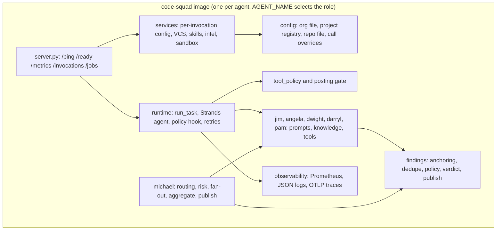
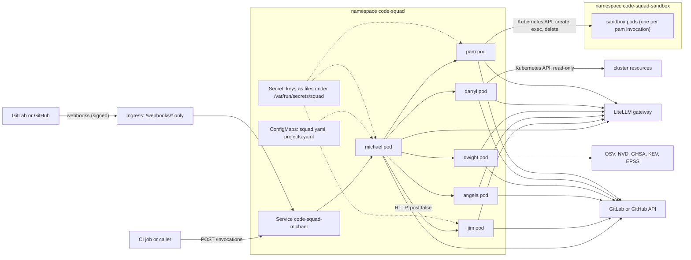

# Architecture overview

Code Squad is one Python package (`code_squad`) and one container image. The image runs as one
of six agents, chosen by the `AGENT_NAME` variable. Every agent is a FastAPI application
served by uvicorn on port 8080. Each invocation creates a new model conversation, runs the
configured tools under a policy, and returns one structured result.

## Components

| Component | Location | Responsibility |
| --- | --- | --- |
| HTTP server | `src/code_squad/server.py` | Routes, readiness, metrics, job state, webhook routes on `michael`. |
| Runtime | `src/code_squad/_common/runtime.py` | Builds the agent, enforces tool policy, retries once, maps the outcome to `complete`, `incomplete` or `failed`. |
| Contract | `src/code_squad/_common/contract.py` | Request, result, finding and verdict models. Unknown keys are rejected. |
| Services | `src/code_squad/_common/services.py` | Builds the configuration, VCS provider, skills and publish policy for one request. Each step degrades on its own. |
| Configuration | `src/code_squad/_common/config/` | Five layers, merge rules, project registry, hot reload, provenance. |
| VCS providers | `src/code_squad/_common/vcs/` | One protocol with GitLab and GitHub implementations and a conformance suite. |
| Findings | `src/code_squad/_common/findings.py` | Deterministic anchoring to changed lines, deduplication, policy, verdict and idempotent publication. |
| Skills | `src/code_squad/_common/skills/` | Discovery, precedence, limits and sanitising of project guidance. |
| Sandbox | `src/code_squad/_common/sandbox/` | One ephemeral pod per `pam` invocation, or a local process for development. |
| Observability | `src/code_squad/_common/observability.py` | Metrics, structured logs and optional traces. |

## Deployment topology on Kubernetes

The Helm chart renders one Deployment and one Service per enabled agent, named
`code-squad-<id>`, from the same image. The other objects are a ConfigMap for the organisation
file and the project registry, the secret references, one ServiceAccount per agent, network
policies, and the RBAC that gives `darryl` read access and `pam` access to the sandbox
namespace. An Ingress exposes only the two webhook paths of `michael`.

The diagram shows the usual traffic. Network policies limit the egress of each pod to its
allow-list. The chart does not create the sandbox namespace; the operator creates it with the
restricted Pod Security label.

## Trust boundaries

| # | Boundary | Crossing | Control |
| --- | --- | --- | --- |
| 1 | GitLab or GitHub to michael | Webhook deliveries | Signature check (`X-Gitlab-Token` or HMAC-SHA256 of the raw body), delivery-id de-duplication, bot-identity and author rules. |
| 2 | CI or any caller to `/invocations` | Direct invocation | Shared bearer token (`SQUAD_API_TOKEN`), required; the endpoints refuse every request without it unless `SQUAD_ALLOW_UNAUTHENTICATED=1`. Also no Ingress route, and network policies in the cluster. See [Hardening](../security/hardening.md#api-authentication). |
| 3 | Repository and change content to the model | Diffs, comments, files, logs, skills, advisories | Wrapped in `<untrusted>` blocks, a rule in every system prompt, and a tool policy that does not depend on the model. See [Prompt injection](../security/prompt-injection.md). |
| 4 | Agents to the model gateway | LLM calls | Gateway URL and key from the environment, LiteLLM tags for attribution. |
| 5 | Agents to the VCS | API calls and, for `pam`, git push | Tokens or GitHub App keys read through the secret provider by name. Git credentials go to a private askpass file for one call. |
| 6 | `pam` to repository code | Package scripts and tests run in the sandbox | No secrets in the sandbox, command allow-list, egress allow-list, deadline, pod destruction. |
| 7 | `darryl` to the cluster and to telemetry backends | Reads | Read-only RBAC, namespace allow-list, no secret resources, redaction and size caps. |
| 8 | `dwight` to advisory sources | Vulnerability queries | Host allow-list, cache, rate limits, optional egress proxy, unverified-data rule. |
| 9 | `michael` to specialists | Internal HTTP fan-out | In-cluster service names, `post: false` by default, idempotency keys, circuit breaker, W3C trace headers. |

## Request lifecycle in one paragraph

A request is validated against the contract (unknown keys are rejected with 422). The service
builder then resolves the effective configuration from the layers, creates the VCS provider,
loads the skills and sets the publish policy. The plan step applies agent settings and refuses
disabled agents. The runtime creates a new agent with the agent's prompt, the untrusted-content
rule and the dry-run note, runs it with a turn limit, and accepts the result only when the agent
called `finish`. Post-run guards may weaken the result. The response is an `InvocationResult`
with the effective configuration hash in `stats.config_hash`.

## Related pages

- [Review sequence](review-sequence.md) for the change-request flow through michael.
- [pam sequence](pam-sequence.md) for implementation.
- [Config layering](config-layering.md) and the [contract](contract.md).
- [Decisions](../decisions/index.md) for the reasons behind the design.
