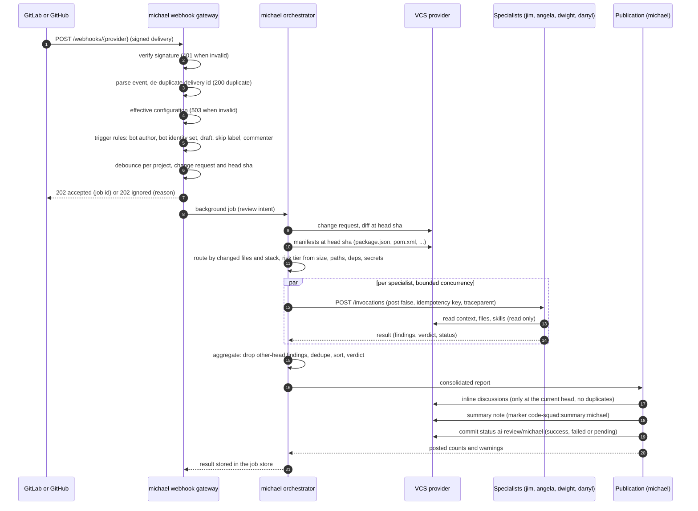

# Change-request review sequence

This page follows one review from a webhook (or a CI call) through `michael`, the specialists,
and the single consolidated publication. The steps match the code in `michael/gateway.py`,
`michael/orchestrator.py`, `michael/aggregate.py` and `michael/publish.py`.

## Sequence

Without a webhook the same path starts from `POST /invocations` on michael with
`mode: "review"` (or a numeric `target`). The CI snippets in `examples/` do exactly that.

## Steps in order

1. **Authenticate the delivery.** GitLab sends `X-Gitlab-Token`; GitHub sends
   `X-Hub-Signature-256`. Both are compared in constant time. A missing or wrong secret returns
   `401`. The secret is named `gitlab-webhook-secret` or `github-webhook-secret`.
2. **Accept the body.** A non-JSON body returns `400`. An unsupported event returns
   `202` with `status: ignored`.
3. **De-duplicate.** A delivery id that already reached a final outcome returns `200` with
   `status: duplicate`. The record is kept in memory, per replica, and is written only once a
   delivery reaches a final outcome, so a transient failure can be redelivered.
4. **Load configuration.** The organisation file and the registry are read for the project.
   An invalid organisation file returns `503`. A project without `vcs.bot_username` is ignored,
   which prevents reacting to the bot's own comments.
5. **Decide the trigger.** Review requests for the bot, pushes when `trigger.on_push` is set,
   and comments that mention `@<bot>` or use `/squad review` or `/squad sec` start a run.
   Draft changes, the `skip-squad` label, titles starting with WIP or Draft, and commenters
   outside `trigger.allowed_commenters` do not. `/squad help` posts the command list.
6. **Debounce.** The same project, change request and head sha within
   `trigger.debounce_seconds` produce one run.
7. **Respond.** The gateway answers `202` before the review runs, so the delivery does not
   time out. The job store holds the state as `running`, then `done` or `failed`.
8. **Read the change.** The diff is read once at the head sha. The changed files and the
   manifests (`package.json`, `pom.xml`, `build.gradle*`) select the stack.
9. **Route.** Built-in and configured routes map changed files to agents. `dwight` runs on every
   review through `routing.always_run`. A route with `requires` only applies when the stack is
   present.
10. **Score the risk tier.** `low`, `medium` or `high`, from changed lines, sensitive paths,
    dependency manifests and secret-like added lines. A high tier gives `dwight` a full-scope
    hint, and any major finding then requests changes.
11. **Fan out.** Each selected specialist gets `post: false`, its own timeout from
    `routing.timeouts_seconds`, and the idempotency key `<request key or head sha>:<agent>`.
    One retry is made for transport errors and 5xx responses with the same key. Three consecutive
    failures open a circuit for 60 seconds.
12. **Aggregate.** Findings for another head are dropped. The rest are merged and deduplicated
    by location and rule, keeping the highest severity and every contributor.
13. **Decide the verdict.** Any specialist that failed, timed out or returned `incomplete` makes
    the verdict `incomplete`. Otherwise a blocker requests changes; a high tier with a major
    requests changes; the major threshold gives `comment`; anything else is `approve`. The
    verdict is never more lenient than a complete specialist's verdict.
14. **Publish once.** Inline discussions are posted only for findings in changed hunks at the
    current head, skipping markers already present. One summary note is upserted. The status
    `ai-review/michael` is set to `success` for approve or comment, `failed` for request changes,
    and `pending` for incomplete. A formal approval is submitted only when `vcs.approve_mode`
    allows it.

## Outcomes

| Situation | Verdict | Status | What the reader sees |
| --- | --- | --- | --- |
| All specialists complete, no blocking findings | `approve` or `comment` | `success` | Summary and inline comments. |
| A blocker, or a high-tier major | `request_changes` | `failed` | Summary and inline comments. |
| A specialist timed out or failed | `incomplete` | `pending` | Summary naming each failed specialist and the reason. |
| No reviewer selected, or the change could not be read | `incomplete` | `pending` | Summary with the reason. |
| Dry run (`post: false` or `force_dry_run`) | As computed | Not set | Result only. Attempted writes are recorded in `warnings`. |

## Things to know

- The specialists do not publish in the default configuration. `routing.specialists_post` can
  be set true only at the organisation level, and then a specialist's own publication is not
  coordinated by michael.
- The job state and the in-flight claim live in the session store (memory, or Redis with `SESSION_STORE_URL`). The
  de-duplication record and the debounce are in memory. With more than one replica and no Redis, a delivery can be
  processed by one replica and its job status read from another. Use a single replica for webhook-driven reviews, or see
  [Scaling and upgrades](../deployment/scaling-upgrades.md).
- Trigger settings (`trigger.events`, WIP titles, bot authors, drafts, skip labels, commenters) are enforced by the gateway.
