# Configuration concepts

Code Squad is configured by YAML files and environment variables. Nothing that changes behaviour
requires a code change or an image rebuild. This page explains how the pieces fit. The complete key list
is the [configuration reference](../reference/configuration.md), generated from the schema. The layer
diagram is on [Configuration layering](../architecture/config-layering.md).

<figure markdown>

<figcaption>A recording of <code>squad config validate</code> and <code>squad config explain</code> on the example files. The transcript
is <a href="../assets/casts/config.cast">config.cast</a>. Play it locally with <code>asciinema play docs/assets/casts/config.cast</code>.</figcaption>
</figure>

## The files

| File | Owner | Where it lives | Purpose |
| --- | --- | --- | --- |
| `squad.yaml` | Platform operator | ConfigMap `code-squad-config`, mounted at `/etc/squad/squad.yaml` | Organisation defaults and platform limits. Keys can also be set with `SQUAD__SECTION__KEY` variables. |
| `projects.yaml` | Platform operator | ConfigMap `code-squad-projects`, mounted at `/etc/squad/projects/` | The project registry: which projects exist, their provider, their secret names, and the profile each one extends. |
| `.squad/config.yml` | Project team | The repository, on the target branch | Review rules for one project: routes, ignore globs, thresholds, skills, implementer settings. |
| `.agents/skills/<name>/SKILL.md` | Project team | The repository, on the target branch | Project guidance for the reviewers and for pam. See [skills authoring](../onboarding/skills-authoring.md). |

Each file starts with the schema hint, for example `# yaml-language-server: $schema=...`, so editors
validate it. The examples in `examples/` show each file.

## Profiles

A profile is a named bundle of overrides. The built-in profiles are:

| Profile | Intent | Main settings |
| --- | --- | --- |
| `strict` | High-risk code, such as payments | Confidence threshold `low`, inline threshold `nit`, CVSS thresholds 7.0 and 4.0, `offline_mode: fail_incomplete`, a smaller medium and high risk threshold (150 and 500 lines). |
| `balanced` | Default for most projects | Empty: the schema defaults. |
| `lenient` | Prototypes and experiments | Confidence threshold `high`, inline threshold `major`, major threshold 5. |

Profiles can be defined in `projects.yaml` (under `profiles:`) or in a directory of profile files, which
overrides the built-ins by name. Use `extends: <profile>` in a registry entry or in a repository file. The
profile is applied first; the keys in the file or entry follow and win.

## Registry matching

A registry entry has a `match`, which is a project key or a glob:

- `*` matches within one path segment; `**` crosses segments.
- Entries apply from least to most specific. An exact key is more specific than a glob, a glob with
  fewer wildcards is more specific than one with more, and a longer literal prefix wins a tie.
- Every matching entry applies, so a glob can set a default and an exact entry can override it.

For example, `acme/web-*` can extend `balanced` for every web repository, while `acme/web-shop` uses
its own provider and App credentials. The recipes show both.

## Keys that restrict the layers below them

Every field has one of three policies. The reference table shows the policy for each key.

- **`free`**: any layer may set it. Most behaviour keys are free.
- **`tighten_only`**: a repository or a call can only make the value stricter. Examples: a lower approve
  mode, a lower threshold for a severity mapping, a subset of skill sources, a narrower commenter list,
  budgets no higher than the platform limit.
- **`org_only`**: only the organisation file or the registry may set it. Examples: the VCS base URL and
  auth, egress hosts, the secret policy, the platform limits, `posting.force_dry_run`, extra agents.

A mergeable list is unioned across layers. A repository can add routes, sensitive paths, protected paths,
ignore globs and redaction patterns. It cannot remove the ones set above it.

### What happens when a rule is broken

If any setting in a repository or call layer breaks a rule, the entire layer is ignored. Nothing from it is
applied. The reason is recorded in the review summary, in the warnings of the result and in
`squad config explain`. A repository author who makes one mistake loses every setting in that file, so
validate it before you push. The rule is deliberate: a partly applied file is hard to reason about.

## Provenance

`squad config explain <project>` prints the effective value of every key with the layer that set it:

```text
vcs.approve_mode: none            (profile:strict)
review.max_findings: 30           (default)
routing.sensitive_paths: [...]    (registry:acme/payments-*, repo)
```

`squad config explain` accepts `--repo-config` to show what a repository file would change. Each review
result carries the hash of the effective configuration in `stats.config_hash`, so a verdict can be traced
to the exact settings that produced it.

## Environment variables

Two forms exist:

- Bootstrap variables such as `LLM_BASE_URL` and `AGENT_NAME` are documented in the
  [environment reference](../reference/environment.md).
- Any configuration key can be set with `SQUAD__SECTION__KEY`, for example
  `SQUAD__AGENTS__DWIGHT__MODEL=sonnet-5-5`. Values are read as YAML scalars. Map keys are lowercased,
  so rule ids with hyphens belong in the YAML file.

## Validation

Validate every file before it is used:

```bash
uv run squad config validate examples/org/squad.yaml
uv run squad config validate examples/repo
uv run squad config schema --kind config
uv run squad config init react > .squad/config.yml
```

The commands print the problems and exit with a non-zero code when a file is invalid. The same schema
checks run in the test suite for every example and every block in these docs.

## Hot reload

The organisation file and the registry are reloaded when they change, and on `SIGHUP`, without a restart.
A failed reload keeps the previous configuration and increments `squad_config_reload_failures_total`.

## Limits

- Platform ceilings in `limits.*` cap budgets, iteration counts, skill sizes and prompt extras. A lower layer
  cannot exceed them.
- Some keys are declared in the schema but not applied at run time yet. They are marked in the reference
  page and in the [handoff](../HANDOFF.md#known-limitations), and the recipes do not depend on them.
