# Contributing

This page covers the working rules of the repository and the four changes a contributor usually makes: an agent, a tool, a
VCS provider and a knowledge pack. It also covers the decision record process and releases. The agent-level conventions are in
`AGENTS.md` at the repository root; this page expands them.

New here? Read [the architecture tour](tour.md) for where things live, then [your first change](first-change.md) for a
walkthrough that ends with a passing gate. [Running and debugging](running-and-debugging.md) shows how to run one agent against the
fake model. The short version of these rules is in [CONTRIBUTING.md](https://github.com/acarmisc/the-office-ai-squad/blob/main/CONTRIBUTING.md).

<figure markdown>

<figcaption>An offline review you can run yourself with <code>uv run python -m scripts.demo_review</code>.
Recording: <a href="../assets/casts/review.cast">review.cast</a>. Play it locally with <code>asciinema play docs/assets/casts/review.cast</code>.</figcaption>
</figure>

## Working rules

- Read `docs/BRIEF.md` (the build brief), `STATUS.md` (current state) and `AGENTS.md` before a change.
- Run `just check` before a commit. The gate must be green; never leave the tree broken.
- Commit at the end of a milestone or a complete change, with conventional commit messages (`feat(scope): ...`,
  `fix(scope): ...`, `docs(scope): ...`) in the imperative mood.
- Python 3.12 or later, `uv` with `uv.lock`, `hatchling` and the `src/` layout. Do not add a dependency without a reason
  recorded in an ADR when it changes the platform.
- Code: short functions, explicit types everywhere (`mypy --strict`), `Enum` or `Literal` instead of boolean flags, private
  names by default (`_name`), frozen dataclasses or pydantic models for data.
- Comments only where they explain a non-obvious *why*. Do not document what the code says.
- Never invent a library API. Inspect the installed package before you call it.
- No secrets in code, tests, fixtures, logs or docs. Use obvious fakes such as `fake-token-for-tests`. The secret scan blocks
  token-shaped strings.
- Tests do not use the network. Use `respx`, the fake VCS provider and the scripted model.
- Security-relevant behaviour (tool policy, dry run, untrusted content, input validation) needs a test first, and the test must
  check the refusal.

## Repository layout

| Path | Content |
| --- | --- |
| `src/code_squad/_common/` | Platform: contract, runtime, policy, configuration, VCS providers, skills, sandbox, services, observability |
| `src/code_squad/<id>/` | One package per built-in agent: `__init__.py` (the `SPEC`), `prompt.md`, `knowledge/` and any tools |
| `src/code_squad/server.py` | HTTP application factory |
| `deploy/` | Dockerfiles, Helm chart, compose, kind scripts, fake LLM, observability and secret examples |
| `schemas/` | Generated JSON Schemas (`scripts/gen_schemas.py`) |
| `examples/` | Organisation, repository, GitLab and GitHub examples |
| `eval/` | Golden cases, fixtures, replays, scorers, runner |
| `docs/` | Documentation (this site), generated reference pages, decision records |
| `scripts/` | Generators, checks, the smoke test and the image bump script |

## Adding an agent

Built-in agents are a platform change, not a configuration change. The six ids are fixed in `_common/registry.py`. To add a seventh
built-in agent:

1. Decide the role, the modes, the tools and the policy class of each tool. Write an ADR first.
2. Create `src/code_squad/<id>/` with `__init__.py` exposing `SPEC` (an `AgentSpec`), `prompt.md` and a `knowledge/` directory with
   an index topic. Follow an existing package: `jim` for a reviewer, `pam` for an implementer.
3. Add the id to `AGENT_IDS` and `ROLES` in `_common/registry.py`, and to the `Literal`s or lists in `_common/config/schema.py` that enumerate the built-in agents.
4. Write the prompt with the required sections (`## Role and boundaries`, `## Untrusted content`, `## Method`, `## Severity rubric`,
   `## Output contract`, `## Dry-run`, `## Tools and skills`, `## Limits`), under 2500 words. `just prompts` checks this.
5. Add the agent to the chart (`agents.<id>` in `values.yaml`, the schema, and the templates that list agents), to `deploy/compose.yaml`,
   to `scripts/smoke_test.sh` and to `catalog-info.yaml`, which needs one Component (type `ai-agent`, see [Backstage](../integrations/backstage.md)) and one API for it.
6. Add tests: the registry test, a scripted run, the policy test that the tools are classified, and the catalogue test.
7. Regenerate the reference pages with `just docs-gen` and update the agent's documentation page and the navigation.

Extra agents (declared in configuration) need none of this; see [Extra agents](../agents/extra-agents.md).

## Adding a tool and classifying it

Every tool an agent can call must be classified in `_common/tool_policy.py`:

| Class | Meaning | Where it can run |
| --- | --- | --- |
| `READ` | Changes nothing | Any agent |
| `LOCAL_MUTATION` | Changes only the sandbox working copy | pam only |
| `EXTERNAL_WRITE` | Changes a remote system | Only the gated tools (`publish_review`, `push_branch`, `open_change_request`) |

Steps:

1. Write the tool as a Strands tool in the agent's package or in `_common/`. Use an explicit signature and a docstring that the model
   reads as its instructions.
2. Add the name to `TOOL_POLICY` with its class. An unclassified name is refused at run time, and a test fails.
3. If it is an external write, call `ctx.gate.require_write(name)` inside the tool body, as well as the policy hook's check. Both
   checks are required.
4. Add the tool to the agent's `SPEC.tools` only. A preset for extra agents is a separate list in `_common/config/presets.py`; a
   preset may contain `publish_review` as its only external write.
5. Add tests: classification, refusal under dry run, and the result shape. Regenerate `reference/tool-policy.md` with `just docs-gen`.

Do not add a tool that changes a cluster. A darryl test scans the source for mutation calls, and the decision record
[ADR 0006](../decisions/0006-darryl-read-only.md) explains why.

## Adding a VCS provider

Follow [Adding a VCS provider](../vcs/adding-a-provider.md). The provider must pass the conformance suite for the fake and the existing
hosts before it is merged.

## Adding a knowledge pack

Follow [Knowledge packs](../onboarding/knowledge-packs.md). A topic that changes review behaviour needs an eval case.

## ADR process

Record a non-trivial choice as an ADR in `docs/decisions/NNNN-title.md`, numbered in sequence. Use the existing files as the form:

- A title line with the number and the decision.
- `Status` (proposed, accepted, superseded by NNNN) and `Date`.
- `Context`: the problem and the constraints, with the brief's section where relevant.
- `Decision`: what was chosen, precisely, with the names of the modules that implement it.
- `Alternatives considered`, when there were real alternatives.
- `Consequences`: what is now true, what is harder, and the open points for review.

An ADR does not change an accepted decision silently. Write a new ADR that supersedes it, and update the old one's status line. The
[decisions index](../decisions/index.md) lists every ADR; add the new one there.

## Release and versioning

Releases are cut from a tag and published by `.github/workflows/release.yml`. The full description, including the artifacts and their
tags, is in [Images, charts and releases](../deployment/images-and-releases.md). The steps for a maintainer:

1. Set the version to `X.Y.Z` in two places: `version` in `pyproject.toml` and `__version__` in `src/code_squad/__init__.py`. Both must
   equal the tag without the `v`.
2. Bump the chart. Leave out `--tag` so `image.tag` stays empty and follows `appVersion`:

   ```bash
   uv run python scripts/bump_image.py --version X.Y.Z --dry-run
   uv run python scripts/bump_image.py --version X.Y.Z
   ```

   The script sets `version` and `appVersion` in `deploy/helm/code-squad/Chart.yaml`. It edits lines, so comments survive.
3. Add a `## [X.Y.Z] - YYYY-MM-DD` section to `CHANGELOG.md`. The release notes are taken from that section.
4. Run `just check`, merge to `main`, then tag the merge commit as `vX.Y.Z` and push the tag:

   ```bash
   git tag -a vX.Y.Z -m "code-squad X.Y.Z"
   git push origin vX.Y.Z
   ```

The `verify` job of the release workflow fails before anything is published when the tag and the versions in those files disagree. A
pre-release tag such as `vX.Y.Z-rc.1` publishes the images and the chart but does not move `latest`.

Contributors do not release. Do not edit `image.tag`, `appVersion` or the image names by hand; the bump script and the release workflow
own them.

## Documentation

The documentation is built with `mkdocs build --strict`, so every link must resolve and every page must be in the navigation.
Generated reference pages must not be edited by hand; run `just docs-gen`. Validated blocks must stay valid: `just test tests/test_docs_examples.py`.
