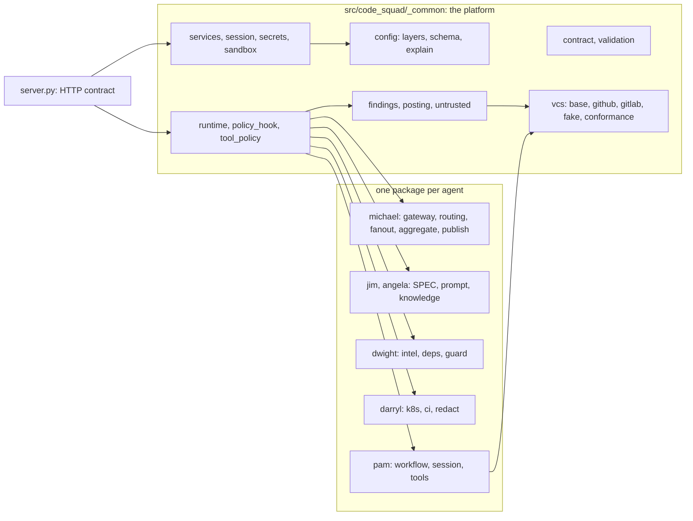

# Architecture tour for contributors

This tour answers one question: when you need to change something, which file do you open, and which test proves the change? Read
[the overview](../architecture/overview.md) first for the product view. This page is the code view.

## Map of the repository

## Where things live

| Path | Responsibility | Tests to run after a change |
| --- | --- | --- |
| `src/code_squad/server.py` | HTTP app: `/ping`, `/ready`, `/metrics`, `/invocations`, `/jobs/{id}`, webhook routes, idempotency | `tests/test_server.py`, `tests/test_idempotency.py`, `tests/test_auth.py` |
| `src/code_squad/_common/contract.py`, `validation.py` | Request and result models; strict validation | `tests/test_contract.py`, `tests/test_validation.py` |
| `src/code_squad/_common/runtime.py` | The agent loop: attempts, retry, `finish`, guards, budgets | `tests/test_runtime.py`, `tests/test_budgets.py` |
| `src/code_squad/_common/tool_policy.py` | Classification of every tool name (`READ`, `LOCAL_MUTATION`, `EXTERNAL_WRITE`) | `tests/test_tool_policy.py` |
| `src/code_squad/_common/policy_hook.py`, `posting.py` | The hook that checks each call; the dry-run gate | `tests/test_posting.py`, `tests/test_tool_policy.py` |
| `src/code_squad/_common/config/` | Layers, merge rules, registry, profiles, `squad config` | `tests/config/`, `tests/test_cli.py`, `tests/test_examples.py` |
| `src/code_squad/_common/services.py` | Per-call services: configuration, VCS provider, secrets, skills | `tests/test_services.py` |
| `src/code_squad/_common/vcs/` | The `VcsProvider` protocol, GitHub and GitLab, the fake, the conformance suite | `tests/vcs/` (including `test_conformance.py`) |
| `src/code_squad/_common/findings.py` | Anchoring, deduplication, verdict, publication of findings | `tests/test_findings.py`, `tests/michael/test_publish.py` |
| `src/code_squad/_common/untrusted.py` | Wrapping diffs, issues, logs and advisories so they are data, not instructions | `tests/test_untrusted.py` |
| `src/code_squad/_common/skills/` | Discovery and loading of project skills from the target branch | `tests/skills/` |
| `src/code_squad/_common/sandbox/`, `secrets/` | Kubernetes and local sandboxes; secret providers | `tests/sandbox/`, `tests/test_secrets.py` |
| `src/code_squad/_common/fake_model.py` | `ScriptedModel`: the deterministic model used by tests and the demo | `tests/test_fake_model.py` |
| `src/code_squad/<id>/__init__.py` | The agent's `SPEC`: model, tools, limits, prompt, knowledge | `tests/test_registry.py`, `tests/agents/` |
| `src/code_squad/<id>/prompt.md`, `knowledge/` | The prompt and the reference packs | `tests/test_prompts.py`, `just prompts` |
| `src/code_squad/michael/` | Gateway (webhooks), routing, risk, fan-out, aggregation, publication | `tests/michael/` |
| `src/code_squad/dwight/` | Dependency parsing, advisory clients, the offline verdict guard | `tests/dwight/` |
| `src/code_squad/darryl/` | Read-only Kubernetes and CI access, redaction | `tests/darryl/` |
| `src/code_squad/pam/` | Implementer workflow, sandbox session, command allow-list | `tests/pam/` |
| `deploy/` | Dockerfiles, Helm chart, compose, kind, fake LLM, observability | `tests/test_chart_render.py`, `tests/test_values_examples_config.py`, `just helm-lint` |
| `schemas/` | Generated JSON Schemas (do not edit by hand) | `tests/test_schemas_sync.py`, `just docs-check` |
| `docs/` | This site. Reference pages are generated (do not edit by hand) | `tests/test_docs_examples.py`, `tests/test_gen_docs.py`, `just docs` |
| `scripts/` | Generators, checks, smoke tests, trial review, demo recording | `tests/test_trial_report.py`, `tests/test_demos.py` |
| `eval/` | Golden cases, fixtures, replays and scorers | `tests/test_eval_scorers.py`, `just eval` |

## The three rules to remember

1. **Every tool is classified** in `_common/tool_policy.py`. An unclassified name is refused at run time, and a test fails.
2. **Dry run is the default and the gate is the only writer.** An external write must check `ctx.gate.require_write(name)` inside the
   tool, as well as the policy hook.
3. **Untrusted text is data.** Diffs, issues, logs and advisories go through `untrusted.py` before they reach a prompt.

These are the rules behind the security invariants in [`AGENTS.md`](https://github.com/acarmisc/the-office-ai-squad/blob/main/AGENTS.md).
A change to any of them needs a test that fails on the old behaviour and an ADR.

## Where to read next

- [Your first change](first-change.md): a step-by-step change with a test.
- [Running and debugging](running-and-debugging.md): run one agent against the fake model.
- [Request lifecycle](../architecture/agent-lifecycle.md): the path a request takes through one agent.
