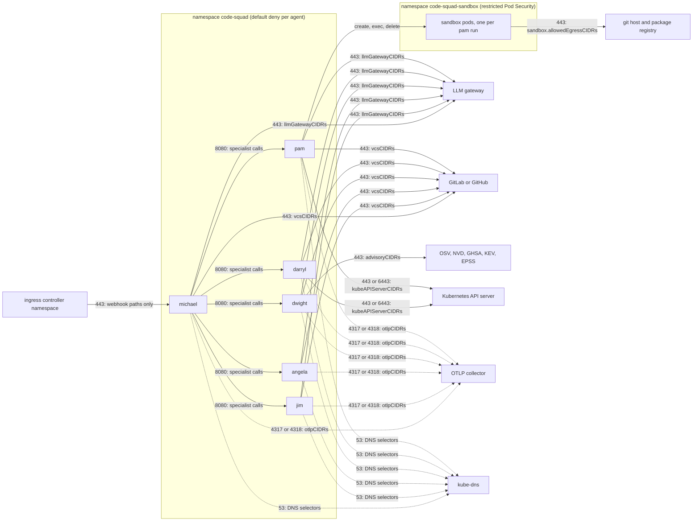

# Network and egress

Each agent needs a small set of outbound destinations, and nothing else. The chart's NetworkPolicies allow exactly
those, when the operator supplies the addresses. This page lists every destination, which agent reaches it, how to
allow it, and what happens when it is blocked.

NetworkPolicies match IP blocks only, so host names cannot be written in them. Either resolve each service to its
address range and keep those ranges current, or route the traffic through an egress proxy and allow only the proxy.

## Topology

The chart renders one NetworkPolicy per agent, each starting from default deny. The diagram shows the allowed flows; each label names
the chart value that opens it.

The sandbox namespace has its own policy. It allows no ingress at all: pam reaches a sandbox pod through the Kubernetes API (create,
exec, delete), not through the pod network. The pods egress only to DNS and to the destinations in `sandbox.allowedEgressCIDRs`.

## Destinations

| Destination | Who | Protocol and port | Chart value | Required |
| --- | --- | --- | --- | --- |
| LLM gateway (LiteLLM) | Every agent | HTTPS 443 (or the gateway's port) | `networkPolicy.llmGatewayCIDRs` | Yes |
| GitLab or GitHub API, git over HTTPS | michael, jim, angela, dwight, darryl (API); pam (API and git) | HTTPS 443 | `networkPolicy.vcsCIDRs` | Yes |
| OTLP collector | Every agent | HTTP 4317 or 4318 | `networkPolicy.otlpCIDRs`, `otlpPorts` | Only when tracing |
| Egress proxy | Every agent that uses `EGRESS_PROXY_URL` | Proxy port (3128 by default) | `networkPolicy.egressProxyCIDRs`, `egressProxyPorts` | Only with `egressProxy.url` |
| Session store (Redis) | Every agent | 6379 | `networkPolicy.sessionStoreCIDRs` | Only with `sessionStore.url` |
| Vulnerability sources: OSV, NVD, GitHub advisories, CISA KEV, FIRST EPSS | dwight | HTTPS 443 | `networkPolicy.advisoryCIDRs` | For full dwight coverage |
| Kubernetes API server | darryl (read), pam (sandbox pods) | HTTPS 443 or 6443 | `networkPolicy.kubeAPIServerCIDRs` | For darryl and pam |
| Prometheus, Loki, Argo CD | darryl | HTTPS | Not in the chart. Add an egress rule for the endpoints you set in `ops.*`. | Only for those adapters |
| Specialists | michael to each specialist | HTTP 8080 in the namespace | Generated | Yes for michael |
| Sandbox pod git host and package registry | pam sandbox pods | HTTPS 443 | `sandbox.allowedEgressCIDRs`, `allowedEgressPorts` | For builds that fetch dependencies |
| DNS | Every agent and sandbox | UDP and TCP 53 | `networkPolicy.dnsNamespaceSelector`, `dnsPodSelector` | Yes |

Ingress: michael accepts traffic from the ingress controller namespace (when the ingress is enabled). Metrics
scraping on port 8080 is allowed from the monitoring namespace selector. Specialists accept calls from michael. Each
agent's policy starts from default deny.

## Proxy and direct egress

The squad has two proxy paths. Know which one each client uses:

- **Platform HTTP clients** (VCS API, git through the sandbox, and the vulnerability clients) read `EGRESS_PROXY_URL`,
  which the chart sets from `egressProxy.url`.
- **The model client** (the LiteLLM gateway) does not read `EGRESS_PROXY_URL`. It uses the standard HTTP client
  settings, which honour `HTTPS_PROXY` and `NO_PROXY` when they are set. To send model traffic through a proxy,
  set those variables on each agent with `agents.<id>.env`, and keep the gateway address in `NO_PROXY` when it is
  inside the cluster.

With `egressProxy.url` set, the proxy CIDRs must also be filled in. Otherwise the agents cannot reach the proxy,
and the proxy rule is not rendered.

## Air-gapped and restricted networks

1. **Mirror the images.** Build `deploy/Dockerfile` with a `PYTHON_IMAGE` that comes from your registry mirror, and
   push the agent and sandbox images to an internal registry. The sandbox needs `node:22-bookworm-slim` as its base.
2. **Decide what the squad may reach.** Set `egressProxy.url` to your proxy, and set the proxy CIDRs. Leave the
   advisory CIDRs empty unless the proxy allows the advisory hosts.
3. **Vulnerability data.** When dwight cannot reach its sources, its findings are marked unverified: an approve is
   withheld, and the summary says the data was unavailable. To avoid repeated failed calls, switch off the sources
   that are unreachable (`security.sources`). A switched-off source also marks the data unavailable, which is
   intended. See the offline rules in [dwight](../agents/dwight.md).
4. **Package registry for pam.** Sandbox builds fetch dependencies. Point the sandbox at your package mirror through
   `sandbox.allowedEgressCIDRs`, and configure the package manager in the repository. The sandbox's corepack downloads
   pinned pnpm and yarn on first use; bake them into a derived sandbox image when the registry is not reachable.
5. **Private certificate authority.** When the VCS host, the gateway or the proxy presents a certificate from a private
   authority, the image has to trust it. The platform has no setting for an extra CA bundle. TODO(architect): decide
   whether the image should trust a mounted CA file, and add the setting if so.
6. **Verify.** Run the smoke test with `scripts/smoke_test.sh k8s` after the install, then a dry-run review on one
   change request. A warning that a source is unavailable is the expected outcome for a source you blocked on purpose.

## Blocked egress: what the reader sees

| Blocked destination | Result |
| --- | --- |
| LLM gateway | The model call fails. The run is `failed` with the exception type, and the verdict is `incomplete`. |
| VCS API | The provider raises a typed error. The run records "VCS unavailable" or a rate-limit warning. The verdict is `incomplete` when a specialist could not read the change. |
| Advisory source | Findings from that source are marked low confidence; an approve is withheld; the run is `comment`, or `incomplete` with `offline_mode: fail_incomplete`. |
| Kubernetes API (darryl) | Tools answer with an error. The prompt asks the model to record the gap. |
| OTLP collector | Traces are dropped; the service keeps running. |
| Sandbox git host | The clone or push fails. pam returns `incomplete` or `request_changes` with the error line. |

## Checking the policy

- `kubectl get networkpolicy -n code-squad` lists one policy per agent and the sandbox policy.
- `kubectl describe networkpolicy code-squad-michael -n code-squad` shows the rules. Confirm the CIDRs are the ones you
  intended.
- From a debug pod that carries the agent's labels, a request to the gateway should succeed, and a request to an
  address outside the allow-list should time out. Do not use the agent container for this test: it is a service
  image with a small toolset.
