# Local demo (5 minutes)

This page runs the squad on your own machine with an offline, scripted model. It needs no API key, no VCS account and no cluster.
Two routes are shown. The first needs only `uv` and takes about two minutes. The second starts all six agents in Docker Compose.

<figure markdown>

<figcaption>A real run of <code>uv run python -m scripts.demo_review</code>. The transcript is in
<a href="../assets/casts/review.cast">assets/casts/review.cast</a>. Play it locally with
<code>asciinema play docs/assets/casts/review.cast</code>.</figcaption>
</figure>

## Route A: one review, no containers (about 2 minutes)

Requires Python 3.12 and [uv](https://docs.astral.sh/uv/). `just` is optional.

```bash
git clone https://github.com/acarmisc/the-office-ai-squad.git
cd the-office-ai-squad
uv sync
uv run python -m scripts.demo_review
```

The script runs `jim` on a sample React change request. The model is scripted, the VCS is an in-memory fake, and the request is a
dry run (`post: false`). Expected output, which is the real output of the command:

```text
dry run: post=false, nothing is written to the VCS.
agent:    jim
status:   complete
verdict:  request_changes
findings: 1 (blocker 1, major 0, minor 0, nit 0)
posted:   notes=0 discussions=0 status=None
tokens:   input=30 output=15
turns:    3
tools:    {"finish": 1, "get_review_context": 1, "read_file": 1}
warnings:
  none
external writes recorded by the fake VCS: 0
```

Read the last line: `external writes recorded by the fake VCS: 0`. A dry run must end with zero writes.

Check the configuration commands as well. This validates the example organisation and repository files and explains the effective
configuration of one project:

```bash
uv run squad config validate examples/org examples/repo
uv run squad config explain acme/web-shop --org examples/org/squad.yaml \
  --projects examples/org/projects.yaml --format yaml
```

Every validated file prints an `ok:` line. The explain output lists each key with the layer that set it. The
[configuration concepts](../configuration/concepts.md) page explains the layers.

## Route B: six agents in Docker Compose (about 5 minutes)

Requires Docker with Compose v2 and a running Docker daemon.

```bash
docker compose -f deploy/compose.yaml up -d --build
scripts/smoke_test.sh compose
```

Compose builds `code-squad:dev` from `deploy/Dockerfile` and starts an offline `fake-llm` plus one container per agent. The smoke
test waits for each agent's `/ready`, sends one dry-run invocation to each, and prints one `PASS` line per agent. It ends with
`smoke compose: all 6 agents passed`. Exit code 1 means at least one agent failed; the message names it.

Send your own request to `michael` on port 8081:

```bash
curl -sS -X POST http://localhost:8081/invocations \
  -H 'content-type: application/json' \
  -d '{"prompt": "smoke test", "post": false}'
```

The response is an `InvocationResult` JSON document. Check these fields:

| Field | Expected for this request |
| --- | --- |
| `status` | `complete` |
| `posted` | zero counts (nothing was published) |
| `warnings` | includes `dry-run blocked ...` only when the scripted run tried a write |
| `stats.config_hash` | a 16-character hash of the effective configuration |

Compose exposes the agents on `127.0.0.1` ports 8081 (michael) to 8086 (pam). The fake LLM is not published to the host. The compose
file sets `SQUAD_ALLOW_UNAUTHENTICATED=1`, which is for this demo only. Production never runs without a token; see
[Deploy to Kubernetes](deploy-to-kubernetes.md).

Stop the stack when you finish:

```bash
docker compose -f deploy/compose.yaml down -v
```

Behind a TLS-intercepting proxy the image build can fail. The [local environments](../deployment/local.md#behind-a-tls-intercepting-proxy)
page describes the base-image step. If something does not start, see [Troubleshooting](troubleshooting.md).

## What you have seen

- The same code path that runs in production: the HTTP contract, the configuration layers, the agent runtime and the publication
  pipeline. The only substitutions are the model and the VCS.
- Dry run as the default way to test. Nothing was written to a VCS.

## Next steps

- Deploy to a cluster: [Deploy to Kubernetes](deploy-to-kubernetes.md), about 15 minutes for the first install.
- Change behaviour for one repository: [New project checklist](../onboarding/new-project.md).
- Work on the code: [Contributing](../contributing/index.md) and [Your first change](../contributing/first-change.md).
