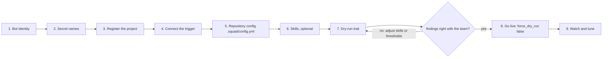

# New project checklist

Use this list to bring one repository under review. It takes a dry run first, so nothing is posted until
the team has seen what the squad would say. Each step names the file or command it changes.

## The flow at a glance



Steps 1 to 3 are platform work and need the platform team. Steps 5 to 7 are repository work and need the project team. Step 7 is the
gate: nothing is posted until it passes.

## Before you start

- [ ] The platform is deployed and `GET /ready` returns `200` for `michael` (see [Helm](../deployment/helm.md)).
- [ ] You know the project's path (`group/repo` or `owner/repo`) and its provider.
- [ ] You have the platform team's contact for the organisation file and the registry.

## 1. Create the bot identity

- [ ] **GitLab:** create a project access token with role Developer and scopes `api` and `read_repository`.
      Add `write_repository` only if `pam` will push branches. Note the bot login (`project_<id>_bot`).
      See [GitLab](../vcs/gitlab.md).
- [ ] **GitHub:** install the GitHub App on the repository (selected repositories). Note the App id, the
      installation id and the App slug. The bot login is `<slug>[bot]`. See [GitHub](../vcs/github.md).

## 2. Store the credentials as secret names

- [ ] Put the token or the App private key in the secret store under a name that matches
      `secrets.allowed_patterns` (by default lower-case letters, digits, dots, dashes and underscores). The
      name, not the value, goes into configuration.
- [ ] For a Kubernetes Secret, add a key with that name. See [Secrets](../deployment/secrets.md).

## 3. Register the project

- [ ] Add an entry to the project registry (`projects.yaml`, platform team). Use the exact project path as the
      `match`, or a glob for a group of repositories.

```yaml
projects:
  - match: acme/web-app
    provider: gitlab
    base_url: https://gitlab.example.com
    auth:
      token_secret: gitlab-web-app-token
    extends: balanced
```

- [ ] Set `vcs.bot_username` to the bot login, in the registry entry or the organisation file.
      Without it, webhook events are ignored.

## 4. Connect the trigger

Choose one.

- [ ] **CI job:** copy `examples/gitlab/gitlab-ci-snippet.yml` into the project's `.gitlab-ci.yml`, or
      `examples/github/github-actions-workflow.yml` into `.github/workflows/`. Set the variables `SQUAD_URL`
      (and `SQUAD_POST`, which stays `false` for now).
- [ ] **Webhook:** confirm `webhooks.<provider>.enabled` is true in the chart, add the secret
      (`gitlab-webhook-secret` or `github-webhook-secret`), and create the webhook as described in
      [GitLab webhook setup](../vcs/gitlab.md) or [GitHub](../vcs/github.md). Use the URL
      `https://<squad host>/webhooks/<provider>`.

## 5. Add the repository configuration

- [ ] Start from a scaffold and validate it:

```bash
uv run squad config init react > .squad/config.yml    # or: java, generic
uv run squad config validate .squad/config.yml
```

- [ ] Keep only the settings the team needs. A repository file that breaks a rule is ignored as a whole, so
      check it with `squad config explain <project> --repo-config .squad/config.yml` before you push.
- [ ] Commit the file to the target branch. The squad reads it from there, not from the change request.

## 6. Add skills (optional, recommended)

- [ ] Write project conventions as skills under `.agents/skills/<name>/SKILL.md`. Start with one for the
      most common review comment. See [skills authoring](skills-authoring.md).
- [ ] Commit them to the target branch. A skill added in the same change request applies after it is merged.

## 7. Dry-run trial

- [ ] Choose an open change request with a known problem and a known clean one.
- [ ] Trigger a review in dry run with a manual call, or with the CI job and `SQUAD_POST=false`. A webhook
      delivery always requests publication, so enable the webhook only after the dry run:

```bash
curl -sS -X POST "$SQUAD_URL/invocations" -H 'content-type: application/json' \
  -d '{"prompt": "Review change request 42 in project acme/web-app.", "project": "acme/web-app", "target": "42", "mode": "review", "post": false}'
```

When the platform requires the shared token, add `-H "Authorization: Bearer $SQUAD_API_TOKEN"` to the call.

- [ ] Check the result: the `verdict`, the `findings`, `stats.skills_applied` (your skills appear here when they
      match), `stats.config_hash`, and every entry in `warnings`. A warning about a rejected layer, an unavailable
      provider or a missing skill must be fixed before go-live.
- [ ] Ask the team whether the findings are right. Adjust the skills or the thresholds and repeat.

## 8. Go live

- [ ] Set `SQUAD_POST=true` in the CI variables, or let the webhook publish (the default for webhooks is to
      publish unless the organisation forces dry run).
- [ ] Announce the squad to the team with the commands they can use: the summary is posted automatically,
      and `/squad review`, `/squad sec` and `/squad implement` (for an issue) are available to the
      commenters listed in `trigger.allowed_commenters`.
- [ ] Decide who may comment: set `trigger.allowed_commenters` before enabling webhook comments.

## 9. After go-live

- [ ] Watch `squad_invocations_total` for the project and the `incomplete` ratio (see the
      [runbook](../operations/runbook.md)).
- [ ] Review the first ten findings with the team. Each false positive is a candidate for a skill, a suppression
      rule or a threshold change, made in a repository change that goes through review.
- [ ] Record the project in the team's register with its owner, its profile and its bot identity.
