# Testing

<figure markdown>

<figcaption>Summary lines from each step of <code>just check</code>, recorded from the real commands by
<code>scripts/record_demos.py</code>. The transcript is <a href="../assets/casts/gate.cast">gate.cast</a>; play it with
<code>asciinema play docs/assets/casts/gate.cast</code>. The Helm and secret-scan steps are not in the recording.</figcaption>
</figure>

The default gate is deterministic and offline. No test calls a model, a VCS host or a cluster. Models are replaced by a
scripted model, VCS hosts by an in-memory fake or by recorded HTTP responses, and Kubernetes by a fake client. Live
evaluation is a separate, opt-in run.

## The gate

`just check` runs, in order: `ruff` (lint and format), `mypy --strict` over `src`, `tests`, `scripts`, `eval` and `deploy`,
`pytest`, the prompt checks, the generated-docs drift check, `mkdocs build --strict`, `helm lint` with `kubeconform`, and the
secret scan. The same commands run in `.gitlab-ci.yml` and `.github/workflows/ci.yml`.

| Command | Checks |
| --- | --- |
| `just lint` | `ruff check .` and `ruff format --check .` |
| `just typecheck` | `mypy src tests scripts eval deploy` |
| `just test` | `pytest` (the whole suite; pass a path to run part of it, for example `just test tests/michael`) |
| `just prompts` | `scripts/check_prompts.py`: each prompt is under 2500 words and has the required sections |
| `just docs-check` | Generated schemas and reference pages have no drift |
| `just docs` | `mkdocs build --strict` |
| `just helm-lint` | `helm lint` and `kubeconform` for the default and the example values |
| `just secret-scan` | Token-shaped strings in tracked files |

## Strategy

| Layer | Where | What it proves |
| --- | --- | --- |
| Unit | `tests/config`, `tests/skills`, `tests/sandbox`, `tests/dwight`, `tests/darryl`, `tests/pam`, `tests/michael`, `tests/vcs` | Rules: merge and tighten-only, skill precedence, command allow-list, redaction, guard behaviour, routing, verdicts |
| Integration | `tests/test_server.py`, `tests/test_runtime.py`, `tests/agents`, `tests/pam/test_workflow.py` | Whole runs through the runtime with a scripted model and a fake VCS |
| Contract | `tests/test_contract.py`, `tests/test_validation.py`, `tests/test_schemas_sync.py` | Payload strictness, finding rules, and that committed schemas match the models |
| Documentation | `tests/test_docs_examples.py`, `tests/test_gen_docs.py`, `tests/test_catalog.py`, `tests/test_examples.py`, `tests/test_demos.py` | Every validated doc block and every example is valid; reference pages match the code; the catalogue lists every agent; the demo renderers and the committed demo files are valid |
| Eval harness | `tests/test_eval_scorers.py`, `tests/test_fake_llm.py` | The scorers and the fake LLM work |

## The fake model

`_common/fake_model.py` provides `ScriptedModel`, a model that replays a list of turns. A turn is text, a tool call or a stop
reason. `load_script(path)` reads a script from a JSON file, and `deploy/fake_llm/scripts/<agent>.json` holds one per agent for the
offline demo. In tests, `tests/support.py` provides helpers: `finish_turn` builds the closing turn, `factory_of` wraps models in a
model factory, and `recording_factory` records which model id each call used.

A test that needs a tool to run builds the sequence of tool calls it expects, then asserts on the result and on the tool's side
effects. A test for a refusal asserts that the side effect did not happen.

## The fake VCS and recorded HTTP

- `_common/vcs/fake.py` (`FakeVcsProvider`) is an in-memory provider with capabilities that a test can remove. It records every
  write. `seed_fake` in `_common/vcs/conformance/scenario.py` fills it with the scenario repository.
- `tests/vcs/recorded.py` holds recorded responses for GitLab and GitHub. The GitLab and GitHub providers run against them through
  `respx`, with `assert_all_mocked=True`, so an unexpected request fails the test rather than reaching the network.

## Conformance suite

`_common/vcs/conformance/suite.py` contains one check per provider behaviour, collected in `ALL_CHECKS`. `tests/vcs/test_conformance.py`
runs every check on the fake, GitLab and GitHub backends. A new provider joins the suite as described in
[Adding a provider](../vcs/adding-a-provider.md#3-pass-the-conformance-suite).

## Documentation tests

- `tests/test_docs_examples.py` finds every block preceded by `<!-- validate: config|config:org|projects|baseline|invocation|helm-values -->`
  under `docs/`, and validates it: a repository block against `RepoConfig` and the restricted-layer rules, an organisation block against
  `SquadConfig`, a registry block against `ProjectsFile`, a baseline against `Baseline`, a request against `InvocationRequest`, and a Helm
  overlay merged over `values.yaml` against `values.schema.json`. It fails when no block is found, and when a kind is missing.
  The same file checks the GitLab and GitHub examples and the GitHub App manifest's permissions.
- `tests/test_gen_docs.py` fails when a generated reference page differs from what the code produces, and tests the version-bump
  script on a copy of the chart.
- `tests/test_catalog.py` parses `catalog-info.yaml` and checks one System, one `ai-agent` Component and one API per registered agent, plus the rules of the Backstage AI Agents plugin (Hire form, annotations).

To add a documented example, write the block with the marker on the line directly before its fence. Run `just test tests/test_docs_examples.py`.

## Evaluation

The evaluation harness is in `eval/`. It seeds a fake VCS with a fixture repository and a change, runs the real agent in dry run
through `ServiceBuilder`, `plan_run` and `run_task`, and scores the result.

- **Cases**: `eval/cases/*.yaml`. Each names the agent, the fixture, the change, the expected findings (`id`, `file`, `lines`,
  `category`, `severity`), the must-not-flag ranges with a reason, an optional injection string, and a replay file.
- **Replays**: `eval/replays/*.json`, scripted model outputs. Replay exercises the pipeline and the scorers. It measures nothing
  about model quality.
- **Scorers** (`eval/scorers.py`): recall (seeded issues found), precision (findings that match a seeded issue), false-blocker rate
  (blockers that match no seeded blocker), must-not-flag hits, and injection resistance (no approval, and no echo of the injected
  text).
- **Fixtures**: `eval/fixtures/react-app` and `eval/fixtures/spring-app`, each with seeded defects.

Run the replay:

```bash
just eval
# or
uv run python -m eval.run --case react-profile-card
```

It writes `eval/reports/report.md`. The file is git-ignored; commit only the directory marker.

### Adding a golden case

1. Add the defect to a fixture under `eval/fixtures/`, or add a new fixture, and keep the change small.
2. Write `eval/cases/<id>.yaml`. Use a head sha and a base sha of 40 hex characters, and list the expected findings with their line
   ranges. Add must-not-flag ranges for code that must not be reported, each with a reason.
3. Write `eval/replays/<id>.json` with the scripted turns the agent should take (the finding it reports, then `finish`).
4. Run `just eval --case <id>` (or `uv run python -m eval.run --case <id>`) and check the scores.
5. Add a line for the case in the agent's page under "How to evaluate", if the case covers a new class of defect.

### Reading the report

The report starts with an aggregate table: cases, recall, precision, false-blocker rate, injection resistance and must-not-flag hits.
Then one table per case: the expected and found counts, the matched count, the verdict, the external writes (which must be zero in dry run),
and the injection result. Each case section lists what was missed, the false positives and the must-not-flag hits.

Replay reports should show recall and precision of 1.00 for the seeded scripts. A change in those numbers means the pipeline or a
scorer changed, not the model.

### Live evaluation

Live runs call a real model. They are never part of the default gate.

```bash
EVAL_LIVE=1 LLM_BASE_URL=https://litellm.example.com/v1 LLM_API_KEY=... uv run python -m eval.run --live
```

Without `EVAL_LIVE=1` and `LLM_BASE_URL`, `--live` prints the reason and exits with code 2. Live results are the only measure of model
quality. Record them with the model alias and the date.

### Coverage gaps

The evaluation set has four cases, two for `jim` and two for `angela`. It has no cases yet for `dwight`, `darryl` (including the
troubleshooting scenarios in the build brief: a crash loop from a bad variable, an out-of-memory kill, and an image pull failure) or
`pam` (a small feature that must pass the checks and produce a change request). The [handoff](../HANDOFF.md) lists these as next steps.

## Writing a unit test for a security rule

Test the refusal, not only the success path. For a new tool, assert that it is classified, that an external write under dry run is
refused and does not run, and that unclassified names are refused. For a new configuration key, assert the merge policy and that a
repository layer that breaks it is rejected as a whole.
